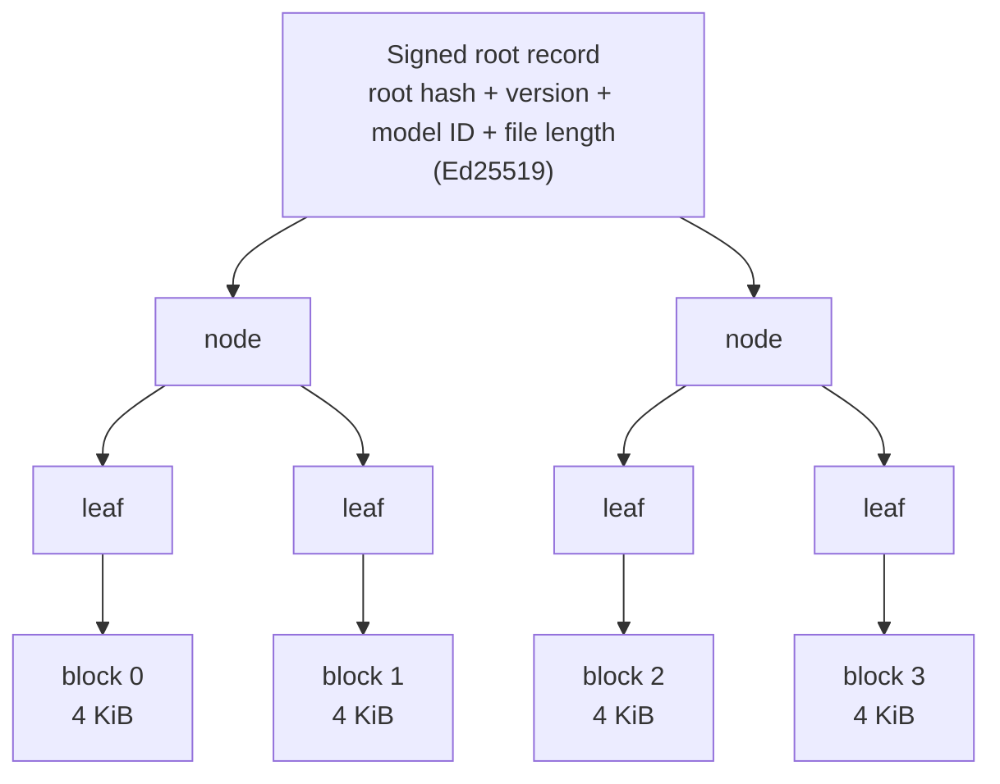
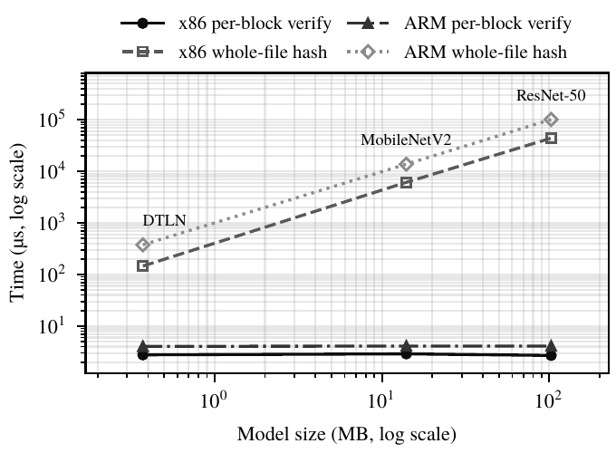
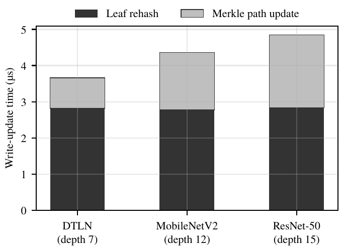
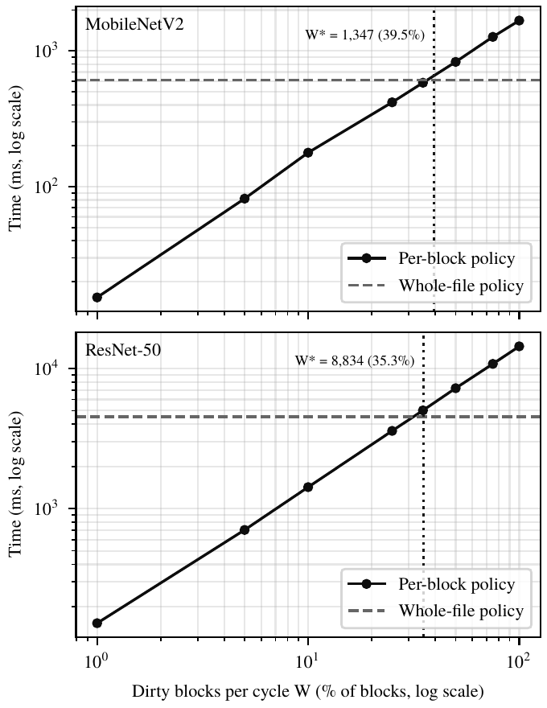
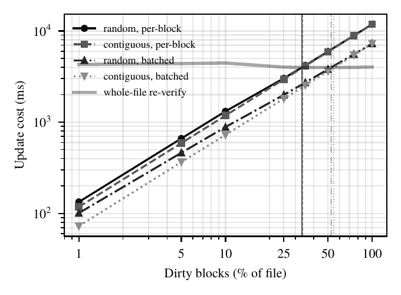

# model-integrity-bench

<p>
  
  
  
  
  
</p>

A checker that catches a tampered AI model file on a small device, checks every read, and still lets the model be updated cheaply and safely.

An AI model on a phone or an edge device is a file of numbers. If one bit in that file changes, the model still loads and still runs. It just gives wrong answers, and nothing warns you. This project splits the model file into 4 KiB blocks under a signed hash tree, so that:

- a read checks only the blocks it touches (about 2.7 µs per block on my laptop, for any model size),
- an honest update re-hashes one path through the tree instead of the whole file (4.9 µs instead of 44 ms for ResNet-50),
- an older signed version of the model is refused (rollback protection),
- a crash in the middle of an update leaves either the full old version or the full new one, never a broken mix that goes unnoticed.

It grew out of [Axiom](https://github.com/abhiprd2000/axiom-os-kernel), a small Rust kernel I wrote that checks file integrity on every read. This repo takes that idea out of the kernel and applies it to real model files: ResNet-50 (ONNX), MobileNetV2 (TFLite) and DTLN (TFLite Micro).

The work was accepted at the SustainableAIoT-Afrasia workshop of IEEE AIoT 2026 after a major revision.

## Contents

- [The problem](#the-problem)
- [Why existing tools fall short](#why-existing-tools-fall-short)
- [How it works](#how-it-works)
- [Try it yourself (about 2 minutes)](#try-it-yourself-about-2-minutes)
- [Results](#results)
- [Reproducing every number](#reproducing-every-number)
- [Repository layout](#repository-layout)
- [Limitations and threat model](#limitations-and-threat-model)
- [Credits](#credits)
- [License](#license)

## The problem

I flipped one bit in one weight of ResNet-50 and loaded it with ONNX Runtime. It loaded with no error, ran inference with no error, and the top-1 label for a dog photo changed from "Samoyed" to "bannister". The same happens with MobileNetV2 in LiteRT. Model runtimes check that a file is well formed. They do not check that the numbers are the ones you shipped.

On a small device the model sits on local storage for months. It can be changed by a bad update, a bug, malware, or a failing flash chip. You want every read checked, and you also want to push small updates (a new classifier head, a fine-tuned layer) without paying for the whole file each time.

## Why existing tools fall short

| | Whole-file hash at load | Linux fs-verity / dm-verity | This checker |
|---|---|---|---|
| When is data checked? | Once, at load | When read from disk; cached pages are trusted | Every read, 2.7 µs per 4 KiB block |
| Can the model be updated? | Yes, but every change re-hashes the whole file (44 ms for ResNet-50) | No. Writes fail with `EPERM`; you rewrite the file and rebuild | Yes. One block plus its path to the root (4.9 µs in memory) |
| One-block update, saved crash-safely (MobileNetV2) | n/a | 547 ms (copy, edit, fsync, re-enable, rename) | 145 ms (3.8× less) |
| Refuses an older signed model? | No | No version in the signature | Yes, signed version number with a minimum floor |
| Runs in the kernel and covers memory-mapped reads? | n/a | Yes (fs-verity's advantage) | No; it uses a verified loader instead |

fs-verity lives in the kernel, so it covers every way a file can be read. This checker is a user-space library and CLI, so it protects reads that go through it. The verified loader (below) is how a model runtime gets its bytes through the checker.

## How it works



Each leaf is the BLAKE3 hash of one 4 KiB block. Parent nodes hash their two children, up to a single root. ResNet-50 has 25,044 blocks, so the tree is 15 levels deep.

Reading. A read of bytes `[offset, offset + len)` maps to the blocks it overlaps. Each of those blocks is hashed and compared with its leaf. If any block does not match, the read stops and names the block. The cost depends on how much you read, not on the size of the model.

Updating. To change one block, the device writes the new data, sets the new leaf, and re-hashes only the nodes on the path from that leaf to the root (`update_leaf` in `src/mib.rs`). When many blocks change at once, the batched version hashes each shared upper node only once. Swapping ResNet-50's classifier head changes 2,001 blocks; batching cuts the node hashes from 30,015 to 2,018.

Signing. The root is never trusted on its own. It sits in a root record together with a version number, a model ID and the file length, and the update service signs that record with Ed25519. Before any read, `open_verified` checks the signature, the model ID, the minimum version, the file length, and that the stored leaves rebuild the signed root. A swapped tree, a different model, a cut or extended file, and an older release are all refused at open.

Saving crash-safely. An update on disk follows five steps:

1. append a journal entry (block, data, leaf, new signed record) and fsync it
2. write the data block
3. write the new leaf and path nodes
4. write the new signed root to a temp file, fsync, and rename it over the old one
5. delete the journal

After a crash, recovery replays a valid journal (the steps are idempotent) and then audits the whole store. The crash tests below kill the process at every one of these steps.

Loading into a runtime. `mib verify-read` streams a model file through the checker and stops at the first bad block. Piping its output into ONNX Runtime or LiteRT gives a verified load: on a tampered ResNet-50 the read stopped at block 12524 and the runtime never started.

## Try it yourself (about 2 minutes)

Needs Rust (stable), `xxd`, and Linux or macOS.

```bash
# 1. Build and get a model (MobileNetV2, 14 MB)
cargo build --release
mkdir -p models
wget -O models/mid.tflite "https://huggingface.co/litert-community/MobileNet-v2/resolve/main/mobilenet_v2.tflite"

# 2. Setup
mib(){ ./target/release/mib "$@"; }
D=/tmp/mib_demo; M=models/mid.tflite; ID="--model-id mobilenet_v2"
mkdir -p $D && mib keygen $D/seed $D/pub
flip(){ b=$(xxd -s $2 -l 1 -p $1); printf "$(printf '\\x%02x' $((0x$b ^ 0x40)))" | dd of=$1 bs=1 seek=$2 conv=notrunc status=none; }

# 3. Seal the model: build the hash tree and sign the root (version 1)
mib seal $M --key $D/seed --version 1 $ID --out $D/v1.mib

# 4. Checked read of the whole file: prints the byte count, 13975904
mib verify-read $M --pubkey $D/pub --sidecar $D/v1.mib $ID | wc -c

# 5. Flip one bit in a copy: the read is refused and names the block
cp $M $D/copy.tflite && flip $D/copy.tflite 5000000
mib verify-read $D/copy.tflite --pubkey $D/pub --sidecar $D/v1.mib $ID > /dev/null
#   -> block 1220 (offset 4997120) failed verification

# 6. Release the same change properly as version 2: accepted
cp $D/copy.tflite $D/v2.tflite
mib seal $D/v2.tflite --key $D/seed --version 2 $ID --out $D/v2.mib
mib verify-read $D/v2.tflite --pubkey $D/pub --sidecar $D/v2.mib $ID --min-version 2 > /dev/null && echo OK

# 7. Try to roll back to version 1: refused
mib verify-read $M --pubkey $D/pub --sidecar $D/v1.mib $ID --min-version 2 > /dev/null
#   -> open refused: Rollback

rm -rf $D
```

`mib verify-read` exits with 0 when every block checks out, 2 when the file is refused at open (bad signature, wrong model, rollback, wrong length, root mismatch), and 3 when a block fails during the read.

The `demo/` folder has a longer four-part demo, including the ResNet-50 bit flip that changes the predicted label. See [demo/README.md](demo/README.md).

## Results

All x86 numbers come from an Intel Core i5-5200U laptop (2 cores, 4 threads, 5400 rpm hard disk, Linux 7.0, Rust release build, most runs pinned to one core). ARM numbers come from a Snapdragon 7 Gen 4 (SM7750) phone running Android 16, using Termux without root. Timings are medians after warm-up; exact values move a little between runs.

### Reading: cost stays flat as models grow

| Model | Size | Blocks | Whole-file hash (x86) | One checked block (x86) | Whole-file hash (phone) | One checked block (phone) |
|---|---:|---:|---:|---:|---:|---:|
| DTLN (TFLite Micro) | 0.36 MiB | 91 | 0.15 ms | 2.84 µs | 0.37 ms | 4.10 µs |
| MobileNetV2 (TFLite) | 13.3 MiB | 3,413 | 6.12 ms | 2.65 µs | 13.8 ms | 4.10 µs |
| ResNet-50 v1-12 (ONNX) | 97.8 MiB | 25,044 | 44.6 ms | 2.77 µs | 100.9 ms | 4.09 µs |

<p align="center"></p>

### Updating: cost follows tree depth, not file size

| Model | Tree depth | Leaf re-hash | Leaf + path (x86) | Leaf + path (phone) | Whole-file re-hash (x86) |
|---|---:|---:|---:|---:|---:|
| DTLN | 7 | 2.81 µs | 3.66 µs | 5.20 µs | 0.17 ms |
| MobileNetV2 | 12 | 2.77 µs | 4.36 µs | 6.00 µs | 5.88 ms |
| ResNet-50 | 15 | 2.84 µs | 4.85 µs | 6.47 µs | 42.8 ms |

Signing a new root adds 28.7 µs; checking a signature takes 70.7 µs. A full `open_verified` on ResNet-50 (signature, length, and rebuilding the root from all 25,044 leaves) takes 4.5 ms.

<p align="center"></p>

A real update: replacing ResNet-50's final fully connected layer (`resnetv17_dense0_weight`, 8 MB, 2,001 blocks, 8% of the file) took 5.85 ms batched and 9.50 ms unbatched, against 43.7 ms to re-hash the whole file. The root after the incremental update is byte-for-byte the same as a root built from scratch on the new file, and the old file is rejected by the new leaves.

### Saving updates to disk, against fs-verity

On the same hard disk, with every write synced:

| Method (MobileNetV2, one 4 KiB block changed) | Median |
|---|---:|
| fs-verity: copy file, change block, fsync, enable verity, rename, sync dir | 547 ms |
| This checker, journal + strict fsync (crash-safe) | 145 ms |
| This checker, in memory only | 0.004 ms |

fs-verity refuses every direct write to a protected file (`open O_WRONLY`, `O_RDWR`, `O_APPEND` and `truncate` all return `EPERM`), so the only way to change one block is to rebuild the file. A later re-run on 28 Oct 2026 gave 178 ms against 444 ms, which is why I report the gain as 2.5× to 3.8×.

### When does per-block stop paying off?

If W blocks change per update cycle, per-block costs W × (leaf + depth × node) and the whole-file scheme costs one full hash. The break-even point is

```
W* = T_file / (t_leaf + d * t_node)
```

| Device, model | Predicted break-even | Measured crossover |
|---|---:|---:|
| Laptop, ResNet-50 | 35.3% of blocks | 33.2% |
| Laptop, MobileNetV2 | 39.5% | 37.0% |
| Phone, ResNet-50 | 62.3% | 61.1% |
| Phone, MobileNetV2 | 67.2% | 65.7% |

Across 12 model and write-rate combinations the cost model predicted the measured time within 1.4% to 11.8%. On the phone, bulk hashing is barely faster per block than single-block hashing, so per-block stays cheaper for much larger updates. A device can measure three constants once and know when to switch to a whole-file re-hash.

<p align="center">&nbsp;</p>

### Security tests: 17 of 17 attacks refused

From `results/r_root.csv`, on MobileNetV2:

| Attack | Result |
|---|---|
| Leaf file tampered | refused at open (RootMismatch) |
| Block edited and its leaf rewritten to match | refused at open (RootMismatch) |
| Leaf file truncated | refused (LengthMismatch) |
| Model file extended by one block | refused (LengthMismatch) |
| Old release (v4) replayed after floor raised | refused (Rollback) |
| Record with version minus 1 | refused (Rollback) |
| v5 after floor raised to v6 | refused (Rollback) |
| One signature bit flipped | refused (BadSignature) |
| Record signed by another key | refused (BadSignature) |
| Version edited without re-signing | refused (BadSignature) |
| Record for a different model | refused (WrongModel) |
| Tampered model file, then a read of the bad block | open succeeds, read refused at block 2000 |

The other five tests check that valid cases are accepted: a valid record, every block of a valid file, v4 at floor 4, the next version v6, and opening a tampered file before the bad block is read.

### Crash tests: 1,600 forced crashes, 0 missed

The test kills the update at every step of the five-step commit, 100 times each, and also tears writes in the middle of the journal, data block and tree path.

| Protocol | Crashes | Ended as old version | Ended as new version | Broken but detected | Broken and undetected |
|---|---:|---:|---:|---:|---:|
| With journal | 1,000 | 200 | 800 | 0 | 0 |
| Without journal (ablation) | 600 | 0 | 100 | 500 | 0 |

With the journal every crash recovers to a clean version. Without it the audit still catches every bad state, for example "data block 2915 does not match its leaf" or "leaves do not reproduce the signed root".

Concurrency: four reader threads checked reads for 922 seconds while a writer applied 10,000 durable updates. That is 430,959,299 checked reads with 0 failed reads, 0 signature failures and 0 version regressions.

### Loading into real runtimes

| ResNet-50 in ONNX Runtime (warm cache) | Plain read | Through `mib verify-read` |
|---|---:|---:|
| Read | 61.5 ms | 259.9 ms |
| Session create | 443.8 ms | 452.5 ms |
| First inference | 128.5 ms | 127.2 ms |
| Total | 633.9 ms | 833.5 ms |

The verified bytes are identical to the plain bytes. With one byte tampered, the plain runtime loaded the model and ran without complaint, while the verified load stopped at block 12524 and the runtime was never created.

Checking the whole file at load is where this design costs more than a single whole-file hash: 94 ms against 66 ms for ResNet-50 with a warm cache. From a cold disk the difference almost disappears (1,250 ms against 1,256 ms, both within 3% of a plain read at 84 MB/s), because the disk is the bottleneck. The gains are in reading parts of a model and in updates.

### BLAKE3 or SHA-256?

Same operations, same laptop: one 4 KiB block takes 2.8 µs with BLAKE3 and 27.5 µs with SHA-256, and a whole ResNet-50 takes 42.8 ms against 689 ms. All results above use BLAKE3.

## Reproducing every number

Get the three models into `models/`:

```bash
mkdir -p models
wget -O models/tiny.tflite  "https://raw.githubusercontent.com/tensorflow/tflite-micro/main/tensorflow/lite/micro/examples/dtln/dtln_noise_suppression.tflite"
wget -O models/mid.tflite   "https://huggingface.co/litert-community/MobileNet-v2/resolve/main/mobilenet_v2.tflite"
wget -O models/large.onnx   "https://github.com/onnx/models/raw/main/validated/vision/classification/resnet/model/resnet50-v1-12.onnx"
cargo build --release
```

The binaries write to `RESULTS_DIR`, which defaults to `./results_arm` (the phone bundle shares the code). Set it to `results` for laptop runs.

| What | Command | Output |
|---|---|---|
| Per-model read and write cost, tamper demo | `RESULTS_DIR=. cargo run --release --bin model-integrity-bench` | `model-integrity-results-x86_64.txt` |
| E1 to E7: block size sweep, tree size, BLAKE3 vs SHA-256, write path, cadence, cost model | `RESULTS_DIR=results cargo run --release --bin experiments` | `results/e*.csv`, `results/e7_summary.txt` |
| Batched updates, ResNet-50 head swap | `RESULTS_DIR=results ./target/release/r_workloads sweep` and `... head` | `results/r_workloads*.csv` |
| Signed root, rollback, 17 security tests | `RESULTS_DIR=results ./target/release/r_root` | `results/r_root.csv` |
| Crash injection, durable update cost, concurrency | `RESULTS_DIR=results ./target/release/r_crash all` | `results/r_crash*.csv` |
| Cold-cache load (needs root, drops page cache) | `sudo ./target/release/r_load_cold` | `results/r_load_cold.csv` |
| fs-verity head-to-head, cold loader (need root) | `bash scripts/run_privileged.sh` | `results/r_fsverity.csv`, `results/r_loader_cold.csv` |
| Verified loader into ONNX Runtime and LiteRT | `.venv/bin/python scripts/loader_bench.py` | `results/r_loader.csv` |
| Figures | `python plot_results.py`, `scripts/plot_f1_arm.py`, `scripts/plot_f8.py` | `figures/F1.pdf` to `F8.pdf` |

The Python scripts need a virtual environment with `onnxruntime`, `ai-edge-litert`, `onnx`, `numpy` and `matplotlib`. The fs-verity test needs a kernel built with `CONFIG_FS_VERITY=y` and the `fsverity` tool.

On a phone: copy `dist/arm_bundle.tar.gz` into Termux's home folder (not shared storage, which is mounted `noexec`), then `tar xzf arm_bundle.tar.gz && cd arm_bundle && bash run_arm.sh`. It downloads the models, checks their hashes and runs the benchmarks without root. My phone results are in `results_arm/` and `results_arm_pinned/`.

## Repository layout

```
src/
  mib.rs            library: leaves, Merkle tree, batched updates, signed root record, sidecar format
  mib_cli.rs        the `mib` CLI: keygen, seal, verify-read
  main.rs           per-model benchmark (read, write, tamper demo)
  experiments.rs    first-round experiments E1 to E7
  r_workloads.rs    batched updates and the ResNet-50 head swap
  r_root.rs         signing, rollback and the 17 security tests
  r_crash.rs        crash injection, durable update cost, concurrency
  r_load_cold.rs    true cold-cache load
scripts/            verified loader, fs-verity benchmark, head-update helper, plots
examples/           small programs used by the demo
demo/               four-part demo with its own README
results/            laptop results (CSV and text)
results_arm/        phone results
results_arm_pinned/ phone results, pinned to one core
figures/            F1 to F8 as PDF, plus PNG copies for this page
dist/               ARM bundle for Termux
```

The code comes from two rounds of work. `main.rs` and `experiments.rs` are the first round (September 2026) and keep their own copy of the tree code, untouched since those results were taken. `mib.rs` is the library written for the revision (October 2026). It pads the tree with zero leaves instead of copying the last leaf, adds batched updates and the signed root record, and is shared by the `mib` CLI and every `r_*` binary. In `results/`, files starting with `e` come from the first round and files starting with `r_` from the revision. CSVs label each value as measured, computed, or derived from measured values.

The Python scripts cover what Rust alone could not measure: loading models into real runtimes, the fs-verity comparison (which needs a kernel feature and root), and the plots. `scripts/run_privileged.sh` runs the root-only tests one after another, never in parallel, because they time disk I/O.

`results_arm/` is the first phone run, which the scheduler could move between the phone's fast and slow cores. `results_arm_pinned/` is the same run pinned to one core with `taskset`; the ARM numbers on this page and in F1 come from there.

One result is superseded. The "cold" rows of `results/e5_load.csv` were not cold: the eviction step left the file in memory, so ResNet-50 "loaded from disk" at 2.5 GB/s on a disk that manages about 85 MB/s. Figure F7's cold panel is drawn from them. `results/e5_method.txt` explains the mistake, and `results/r_load_cold.csv` holds the corrected numbers. The warm rows of E5 are still valid.

## Limitations and threat model

The attacker can change the model file, the leaf file, or the sidecar on storage, and can replay an older signed release. The attacker does not have the update service's signing key.

Things this does not handle yet:

- The minimum version is stored in an ordinary file. Anyone with admin access to the device can lower it and roll back to an older signed model. Fixing that needs a hardware anchor, such as eMMC RPMB, a TPM counter, or a nonce from a server. This is the main open question for me.
- It runs in user space. Memory-mapped reads that bypass the library are not checked; fs-verity covers those and this does not.
- After a read is checked, the bytes in the caller's buffer can still be changed. Per-read checking shortens that window, it does not remove it.
- All x86 numbers come from one laptop with a hard disk, and all ARM numbers from one phone. A dedicated embedded board (for example a Raspberry Pi) is the next device to test.

## Credits

Thanks to Prof. Subodh Kumar (IIT Delhi) for his feedback on the design of Axiom, especially on how to profile it and on moving to block-level checking.

Built with the [blake3](https://crates.io/crates/blake3), [ed25519-dalek](https://crates.io/crates/ed25519-dalek), [sha2](https://crates.io/crates/sha2) and [memmap2](https://crates.io/crates/memmap2) crates, with ONNX Runtime and LiteRT for the loader tests. The test models are ResNet-50 v1-12 from the ONNX Model Zoo, MobileNetV2 from litert-community, and DTLN from the TensorFlow Lite Micro examples. The design borrows ideas from Linux fs-verity and dm-verity and from The Update Framework (TUF).

## License

MIT. See [LICENSE](LICENSE).
